<div align="center">

**UNIVERSIDADE FEDERAL DE SANTA CATARINA**<br>
Engenharia de Computação<br>
DEC7555 - Linguagem de Descrição de Hardware<br>
Prof. Rodrigo V. M. Pereira

<br>

# Jogo de Reflexo na FPGA com Nios II

**Trabalho Prático 4 - Soft/Hard Processor**

Arthur Henrique Janing<br>
Arthur Bogoni

Araranguá, 2026

</div>

---

## Resumo

Este trabalho apresenta um jogo de tempo de reação feito na placa DE10-Lite (FPGA MAX 10). O jogador aperta um botão para começar, espera os LEDs acenderem depois de um tempo sorteado e aperta de novo o mais rápido que conseguir. O tempo aparece no display de 7 segmentos em milissegundos, e o programa guarda o recorde e um ranking dos 5 melhores tempos. A medição do tempo foi feita em hardware próprio, em Verilog, e as regras do jogo rodam num processador Nios II (soft processor) montado dentro da FPGA e programado em C. O projeto também tem uma saída VGA opcional, que mostra no monitor, em tamanho grande, o mesmo texto dos displays, com a cor da tela mudando conforme o momento do jogo. O sistema foi simulado no ModelSim, compilado no Quartus Prime Lite 18.1 e testado na placa.

**Palavras-chave:** FPGA, Verilog, Nios II, soft processor, DE10-Lite.

## Sumário

1. [Introdução](#1-introdução)
2. [Como jogar](#2-como-jogar)
3. [Arquitetura do projeto](#3-arquitetura-do-projeto)
4. [Módulos em Verilog](#4-módulos-em-verilog)
5. [O processador Nios II](#5-o-processador-nios-ii)
6. [Programa em C](#6-programa-em-c)
7. [Saída VGA](#7-saída-vga)
8. [Passo a passo para montar e rodar](#8-passo-a-passo-para-montar-e-rodar)
9. [Simulação no ModelSim](#9-simulação-no-modelsim)
10. [Compilação no Quartus](#10-compilação-no-quartus)
11. [Testes na placa](#11-testes-na-placa)
12. [Problemas que podem acontecer](#12-problemas-que-podem-acontecer)
13. [Conclusão](#13-conclusão)
14. [Referências](#14-referências)

---

## 1. Introdução

O objetivo do trabalho era fazer um projeto em FPGA que tivesse um processador, hard ou soft, e documentar o passo a passo no GitHub. A gente escolheu um jogo de reflexo porque ele usa bem as duas partes: o hardware mede o tempo com precisão e o processador cuida das regras.

Requisitos do trabalho e como foram atendidos:

| Requisito | Como atendemos |
|---|---|
| Ter um hard ou soft processor | Nios II/e, um soft processor montado no Platform Designer, rodando o `sw/main.c` |
| Relatório no GitHub com passo a passo | Este README (seção 8 tem o passo a passo) |
| Apresentação para a turma | Jogo ao vivo, com a turma jogando |

A maior parte do projeto está em Verilog (pasta `hw`). O C só cuida das regras do jogo.

Ferramentas usadas:

- Quartus Prime Lite 18.1, com o suporte ao MAX 10 (o Platform Designer e o Nios II EDS já vêm junto)
- ModelSim-Altera 10.1d, para a simulação
- Placa DE10-Lite (chip 10M50DAF484C7G)

Usamos a versão 18.1 do Quartus porque ela suporta a DE10-Lite e é a última em que o Nios II funciona no Windows sem precisar instalar o WSL. A partir da 24.1 o Nios II nem existe mais, só o Nios V.

## 2. Como jogar

- O display mostra `PLAY`. Aperte o **KEY0** pra começar.
- O display mostra `----`. Espere: depois de 1 a 5 segundos (sorteado) todos os LEDs acendem.
- Quando os LEDs acenderem, aperte o KEY0 o mais rápido que conseguir.
- O display mostra seu tempo, por exemplo `0.243` (243 ms).
- Se apertar antes dos LEDs acenderem, aparece `CEdO` e a rodada não vale.
- Se ninguém apertar, o tempo para em `9.999`.
- **KEY1** apaga o recorde e o ranking.
- Quando sai um recorde novo, os LEDs piscam 3 vezes.

No computador, o terminal do Nios mostra os tempos e o ranking:

```
Rodada 3: espere os LEDs acenderem...
Seu tempo: 0.180 s
*** NOVO RECORDE! ***
------ RANKING ------
1. 0.180 s  (rodada 3)
2. 0.250 s  (rodada 1)
---------------------
```

<p align="center">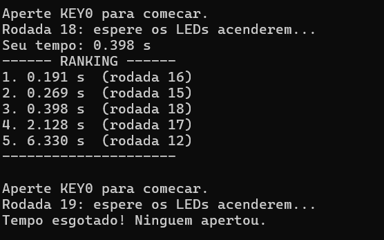<br><i>Figura 1 - Terminal do Nios durante o teste na placa</i></p>

## 3. Arquitetura do projeto

A ideia foi dividir assim:

- **Hardware (Verilog):** mede o tempo com precisão de 1 ms e para o tempo no exato momento em que o botão é apertado. Também sorteia o número da espera e controla os displays e o VGA.
- **Nios II (C):** espera o tempo sorteado, vê se o jogador apertou cedo, acende os LEDs, lê o tempo medido e atualiza recorde e ranking.

Fizemos a medição em hardware porque assim o tempo para no mesmo clock em que o botão é apertado (20 ns a 50 MHz), sem depender do programa. Se fosse no C, o tempo dependeria de quanto o laço demora para ver o botão.

<p align="center">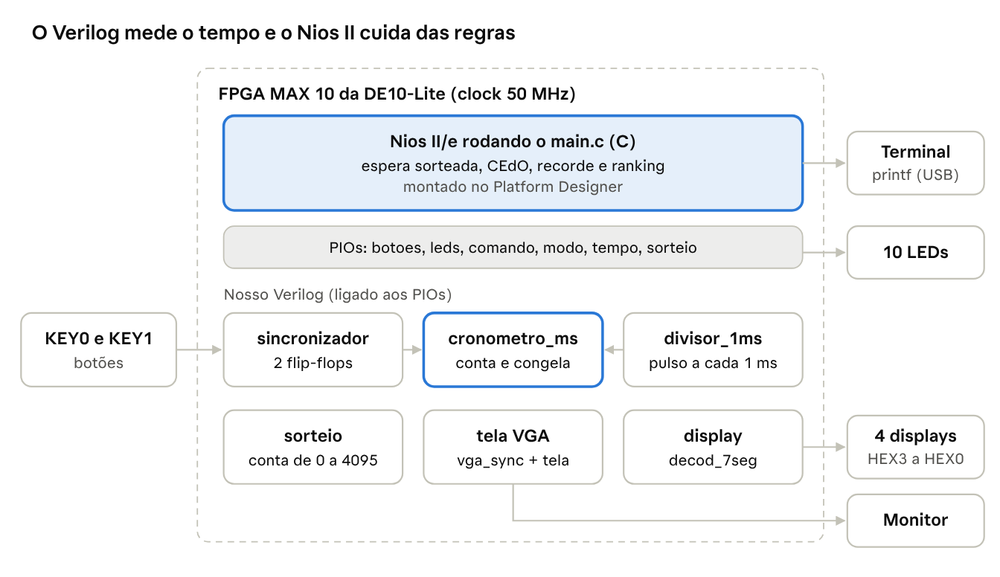<br><i>Figura 2 - Diagrama de blocos do projeto</i></p>

O botão vai direto para o cronômetro, passando só pelo sincronizador. O Nios conversa com o nosso hardware pelos PIOs.

Arquivos do projeto:

```
hw/          Verilog (10 módulos)
sw/main.c    programa do Nios II
sim/         testbenches e o script do ModelSim
quartus/     scripts do Platform Designer e do Quartus, pinos e clock
docs/img/    figuras deste relatório
MONTAR.bat   compila tudo
JOGAR.bat    grava a placa e roda o jogo
```

## 4. Módulos em Verilog

| Arquivo | Linhas | O que faz |
|---|---|---|
| `divisor_1ms.v` | 34 | gera um pulso a cada 1 ms |
| `cronometro_ms.v` | 70 | conta o tempo em BCD e congela no aperto |
| `sorteio.v` | 18 | contador de 12 bits pro sorteio |
| `decod_7seg.v` | 26 | converte um dígito pros 7 segmentos |
| `display.v` | 52 | escolhe o que aparece nos displays |
| `vga_sync.v` | 52 | sincronismo do VGA 640x480 |
| `digito_tela.v` | 47 | desenha um dígito de 7 segmentos grande no monitor |
| `tela.v` | 82 | cor de cada pixel do monitor |
| `reflexo_top.v` | 114 | liga tudo nos pinos da placa |
| `teste_sem_nios_top.v` | 50 | top pra testar o hardware sem o Nios |

### 4.1 `divisor_1ms.v`

O clock da DE10-Lite é 50 MHz, então 1 ms são 50.000 ciclos. O módulo conta até 49.999 e solta um pulso `tique` de um ciclo.

```verilog
else if (contador == CLOCKS_POR_MS - 1) begin
    contador <= 0;
    tique    <= 1;
end
```

Ele só conta enquanto a entrada `ligado` vale 1. Quando desliga, volta pra zero. Assim, quando o cronômetro é armado, o primeiro milissegundo é sempre inteiro. Sem isso a medida podia errar em até 1 ms.

### 4.2 `cronometro_ms.v`

Soma 1 a cada `tique`, em BCD (um dígito decimal a cada 4 bits), de 0.000 até 9.999 s. Funciona igual a um hodômetro: quando a unidade passa de 9, volta a 0 e vai um para a dezena.

- `zerar = 1`: volta pra 0.000
- `armar = 1`: começa a contar
- `botao = 1` com o cronômetro armado: liga `parado` e congela o tempo

```verilog
else if (armar && !parado) begin
    if (botao) begin
        parado <= 1;              // congela o tempo
    end
    else if (tique) begin
        ...
```

Usamos BCD porque cada grupo de 4 bits já é um dígito pronto pro display, sem precisar dividir por 10.

### 4.3 `sorteio.v`

Um contador de 12 bits (0 a 4095) que soma 1 a cada clock. O Nios lê o valor na hora em que o jogador aperta pra começar. Como ninguém consegue apertar sempre no mesmo instante, o número sai diferente toda vez. A espera é 1000 ms + esse número, ou seja, de 1 a 5,1 s.

### 4.4 `decod_7seg.v` e `display.v`

O `decod_7seg` é um `case` que converte um dígito de 0 a 9 nos 7 segmentos. Na DE10-Lite os segmentos acendem com 0.

O `display` escolhe o que aparece nos 4 displays da direita, conforme o modo que o Nios manda:

| modo | Mostra |
|---|---|
| 0 | o tempo, ex. `0.243` |
| 1 | `PLAY` |
| 2 | `----` |
| 3 | `CEdO` |

As letras são `localparam` com o desenho de cada uma. O HEX5 e o HEX4 ficam apagados.

### 4.5 `reflexo_top.v`

Liga os pinos da placa, o sistema do Nios e os nossos módulos. Também tem um sincronizador de 2 flip-flops no botão:

```verilog
always @(posedge MAX10_CLK1_50) begin
    botao_a <= ~KEY[0];
    botao_b <= botao_a;
end
```

O botão é um sinal externo e pode mudar a qualquer momento, inclusive no meio de uma borda do clock. Passando por dois flip-flops, o valor que chega no cronômetro já está estável. O `~` inverte o botão, porque o KEY vale 0 quando apertado.

### 4.6 `teste_sem_nios_top.v`

Um top só pra testar o hardware sem o Nios, usando as chaves: SW0 arma, SW1 zera, SW9 e SW8 mudam o modo do display e o KEY0 para o tempo. Foi útil pra testar o cronômetro e os displays antes de colocar o processador.

## 5. O processador Nios II

O Nios II é um processador que não existe como chip: ele é montado dentro da FPGA, usando os blocos lógicos dela. Por isso é um soft processor. Usamos a versão Nios II/e, a mais simples, que é gratuita no Quartus Lite.

O sistema foi montado no Platform Designer (`sistema_nios.qsys`) com estes componentes:

| Componente | Nome | Para que serve |
|---|---|---|
| Nios II/e | `cpu` | roda o programa em C |
| On-Chip Memory (32 KB) | `memoria` | guarda o programa e as variáveis |
| JTAG UART | `jtag_uart` | manda os `printf` pro terminal do computador |
| System ID | `sysid` | identifica o sistema |
| PIOs | `botoes`, `leds`, `comando`, `modo`, `tempo`, `sorteio` | ligação entre o C e o Verilog |

<p align="center">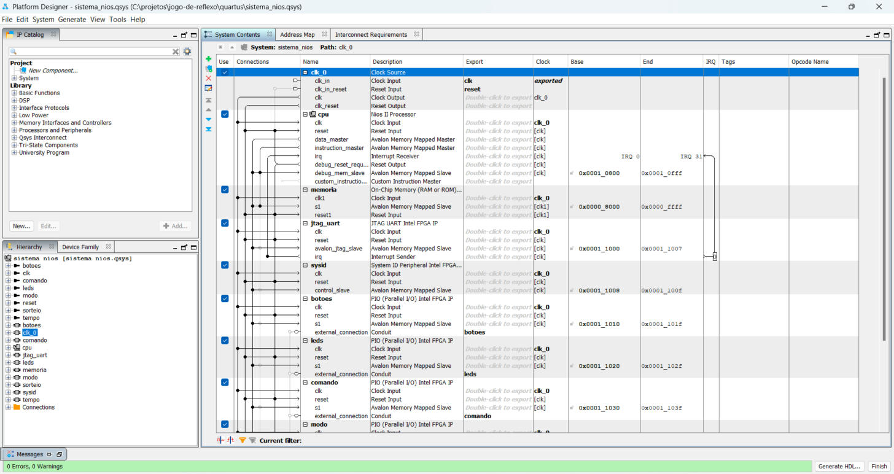<br><i>Figura 3 - Sistema do Nios II no Platform Designer</i></p>

O Nios conversa com o nosso hardware por PIOs (registradores do Platform Designer). No C, cada PIO é um endereço de memória: a gente escreve com `IOWR_ALTERA_AVALON_PIO_DATA` e lê com `IORD_ALTERA_AVALON_PIO_DATA`.

| PIO | Direção | Bits | Uso |
|---|---|---|---|
| botoes | entrada | 2 | KEY1 e KEY0 |
| leds | saída | 10 | LEDR9..LEDR0 |
| comando | saída | 2 | bit 0 = armar, bit 1 = zerar |
| modo | saída | 2 | 0 = tempo, 1 = PLAY, 2 = ----, 3 = CEdO |
| tempo | entrada | 16 | tempo medido em BCD |
| sorteio | entrada | 12 | número sorteado |

## 6. Programa em C

O `sw/main.c` tem algumas funções pequenas e um `while (1)` que repete as rodadas. Exemplo de como o C acende os LEDs e lê o tempo:

```c
IOWR_ALTERA_AVALON_PIO_DATA(LEDS_BASE, 0x3FF);     // acende os 10 LEDs
int bcd = IORD_ALTERA_AVALON_PIO_DATA(TEMPO_BASE); // le o tempo medido
```

Uma rodada:

1. O C mostra `PLAY` e espera o KEY0.
2. Lê o `sorteio` e calcula a espera: 1000 ms + número.
3. Mostra `----`, zera o cronômetro e espera, olhando o botão a cada 1 ms. Se apertarem antes, mostra `CEdO` e a rodada não vale.
4. Acende os LEDs e arma o cronômetro.
5. O hardware conta os ms e para sozinho quando o botão é apertado.
6. O C lê o tempo, converte de BCD pra número, mostra no display e atualiza recorde e ranking.

A conversão do BCD separa os 4 dígitos com deslocamento e máscara. Por exemplo, `0x0243` vira 0×1000 + 2×100 + 4×10 + 3 = 243 ms.

O ranking é um vetor de 5 posições. Cada tempo novo entra na posição certa (menor primeiro) e os de baixo descem uma casa.

## 7. Saída VGA

Se tiver um monitor ligado na saída VGA da placa, ele funciona como um display gigante: mostra o mesmo texto dos displays da placa, com 4 dígitos grandes no meio da tela, e a cor do fundo muda junto com o jogo. Assim quem está assistindo consegue ver o tempo de longe. Não é obrigatório, o jogo funciona sem monitor.

| Momento | Fundo | Texto |
|---|---|---|
| `PLAY` | azul | `PLAY` em branco |
| esperando | vermelho | `----` em branco |
| hora de apertar | verde | `----` em preto |
| `CEdO` | amarelo | `CEdO` em preto |
| resultado | preto | o tempo (ex. `0.243`) em branco e uma barra branca embaixo, do tamanho do tempo |

O ranking continua aparecendo só no terminal do PC, porque ele fica guardado no programa em C.

O `vga_sync.v` gera o sincronismo de 640x480 a 60 Hz. O pixel é de 25 MHz, então ele anda um pixel a cada 2 clocks de 50 MHz. Cada linha tem 800 pixels (640 visíveis) e cada tela tem 525 linhas (480 visíveis): 25.000.000 / (800 × 525) = 60 telas por segundo.

O `tela.v` escolhe a cor de cada pixel. Os dígitos grandes reaproveitam os mesmos segmentos que vão pros displays da placa (saem do `display.v`), então o monitor sempre mostra igual à placa. Cada dígito é desenhado pelo `digito_tela.v`, que tem 100 x 180 pixels e trata cada segmento como um retângulo de 16 pixels de grossura: se o pixel cai dentro de um segmento aceso, ele é pintado.

```
 aaaaaa
f      b
f      b
 gggggg
e      c
e      c
 dddddd
```

Na hora do resultado, também aparece uma barra embaixo dos dígitos com 1 pixel a cada 16 ms, então 9.999 ms cabe nos 640 pixels da tela.

<!-- FIGURA: foto do monitor (tela verde ou barra do resultado)
<p align="center">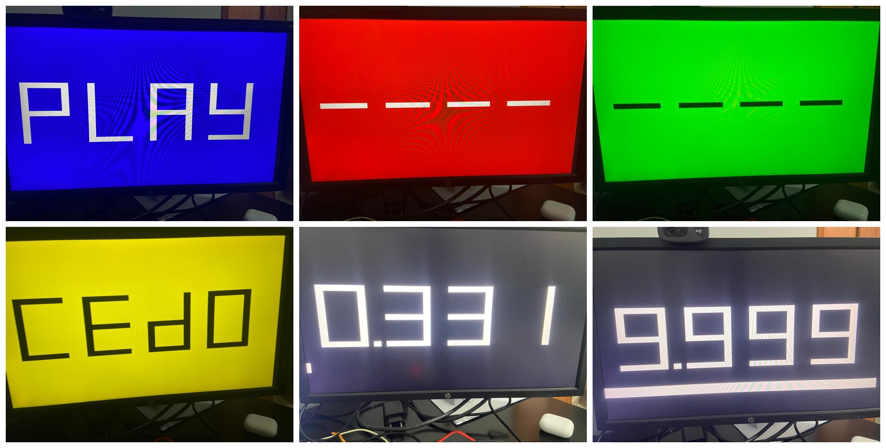<br><i>Figura 4 - Saída VGA mostrando o resultado de uma rodada</i></p>
-->

## 8. Passo a passo para montar e rodar

### 8.1 O que precisa

- Quartus Prime Lite 18.1, com o suporte ao MAX 10 (o Nios II EDS já vem junto)
- Placa DE10-Lite (chip 10M50DAF484C7G) e cabo USB
- Driver do USB-Blaster (fica em `C:\intelFPGA_lite\18.1\quartus\drivers\usb-blaster`)
- ModelSim, só pra rodar a simulação
- Monitor com entrada VGA, se quiser ver a tela colorida (opcional)

Os instaladores ficam na página do Quartus Prime Lite 18.1 no site da Altera. Os arquivos são `QuartusLiteSetup-18.1.0.625-windows.exe` e `max10-18.1.0.625.qdz`, que têm que estar na mesma pasta na hora de instalar.

### 8.2 Jeito rápido

O projeto tem que estar em `C:\projetos\jogo-de-reflexo` (pode baixar pelo Code > Download ZIP e renomear a pasta).

1. Dois cliques no `MONTAR.bat`. Ele monta o Nios no Platform Designer, compila no Quartus e compila o C. Demora alguns minutos e não precisa da placa. A saída fica em `montar_log.txt`.
2. Liga a DE10-Lite no USB e dá dois cliques no `JOGAR.bat`. Ele grava a placa, carrega o programa e abre o terminal com o ranking.

Se não mudou nada no Verilog, o `MONTAR.bat` pula o Quartus e só compila o C de novo (fica bem mais rápido).

Pra abrir o projeto no Quartus e mostrar as telas: File > Open Project > `quartus/reflexo.qpf`. O Nios abre pelo Tools > Platform Designer > `quartus/sistema_nios.qsys`.

### 8.3 Passo a passo manual (pelo Quartus)

É o que os scripts fazem, mas pelas telas do Quartus.

**1. Criar o projeto**

- File > New Project Wizard. Pasta `quartus`, nome `reflexo`.
- Family: MAX 10, Device: 10M50DAF484C7G.
- Adicionar os arquivos `hw/divisor_1ms.v`, `cronometro_ms.v`, `decod_7seg.v`, `display.v`, `teste_sem_nios_top.v` e o `quartus/restricoes.sdc`.
- Tools > Tcl Scripts > `quartus/pinos_de10lite.tcl` > Run, pra colocar os pinos.
- Em Assignments > Device > Device and Pin Options > Configuration, colocar o modo "Single Uncompressed Image with Memory Initialization" (precisa pra RAM do Nios).

**2. Testar o hardware sem o Nios**

- Top-level: `teste_sem_nios_top`. Processing > Start Compilation.
- Tools > Programmer > Hardware Setup: USB-Blaster > Start.
- Testar com as chaves: SW9 e SW8 mudam o display (`PLAY`, `----`, `CEdO`), SW1 zera, SW0 começa a contar e o KEY0 para o tempo.

**3. Montar o Nios II no Platform Designer**

Tools > Platform Designer. Adicionar estes componentes com estes nomes (o C usa esses nomes):

- `cpu`: Nios II Processor, versão Nios II/e
- `memoria`: On-Chip Memory, RAM de 32768 bytes (desmarcar "Initialize memory content")
- `jtag_uart`: JTAG UART
- `sysid`: System ID Peripheral
- PIOs: `botoes` (entrada, 2 bits), `leds` (saída, 10), `comando` (saída, 2), `modo` (saída, 2), `tempo` (entrada, 16), `sorteio` (entrada, 12)

Ligações:

- `clk_0.clk` no clock de todos, e `clk_0.clk_reset` e `cpu.debug_reset_request` no reset de todos.
- `cpu.data_master` em todos os escravos (`memoria.s1`, `cpu.debug_mem_slave`, `jtag_uart`, `sysid` e os PIOs).
- `cpu.instruction_master` na `memoria.s1` e no `cpu.debug_mem_slave`.
- IRQ da `jtag_uart` no `cpu`.
- No `cpu`, Reset Vector e Exception Vector na `memoria.s1`.
- Exportar `clk_in` como `clk`, `clk_in_reset` como `reset` e o `external_connection` de cada PIO com o nome do PIO.
- System > Assign Base Addresses. Salvar como `sistema_nios.qsys` e gerar em Verilog (Generation > Generate).

**4. Compilar o projeto completo**

- Adicionar o `sistema_nios/synthesis/sistema_nios.qip`, o `hw/sorteio.v`, o `hw/vga_sync.v`, o `hw/digito_tela.v`, o `hw/tela.v` e o `hw/reflexo_top.v`, e tirar o `teste_sem_nios_top.v`.
- Top-level: `reflexo_top`. Compilar e gravar com o Programmer.

**5. Programa do Nios**

- Tools > Nios II Software Build Tools for Eclipse.
- File > New > Nios II Application and BSP from Template, usando o `sistema_nios.sopcinfo` e o template Hello World Small.
- Trocar o `hello_world_small.c` pelo `sw/main.c`, compilar (Build Project) e rodar (Run As > Nios II Hardware).

## 9. Simulação no ModelSim

Fizemos dois testbenches:

- `sim/tb_reflexo.v` testa o projeto inteiro. Como o Nios de verdade não dá pra simular fácil, o `sim/sistema_nios_falso.v` faz o papel dele: tem as mesmas portas, e o testbench escreve direto nos PIOs.
- `sim/tb_vga.v` testa o VGA.

Pra rodar os dois: no ModelSim, File > Change Directory, escolher a pasta do projeto e digitar no Transcript:

```
do sim/simular.do
```

No final de cada teste aparece `TODOS OS TESTES PASSARAM`. O teste do jogo demora uns 4 minutos, porque simula mais de meio segundo clock por clock.

Resultados do `tb_reflexo.v`:

| Teste | Resultado |
|---|---|
| apertar 243,5 ms depois de armar | mede 0.243 |
| soltar o botão depois | o tempo continua 0.243 |
| zerar | volta pra 0.000 |
| apertar com o cronômetro desarmado | não muda nada |
| displays | `PLAY`, `----`, `CEdO` e `0.243` com o ponto no lugar certo |
| ninguém aperta | para em 9.999 |
| sorteio | o número fica mudando |

Resultados do `tb_vga.v`:

| Teste | Resultado |
|---|---|
| duração de uma linha | 32 us |
| pulso do hsync | 3,84 us |
| linhas por tela | 525 (60 Hz) |
| cores de cada momento | todas certas |
| dígitos grandes (`PLAY`, `----`, `CEdO`, `0.243` e o ponto) | segmentos certos, na cor certa |
| barra de 243 ms e de 9.999 ms | tamanho certo |

<p align="center">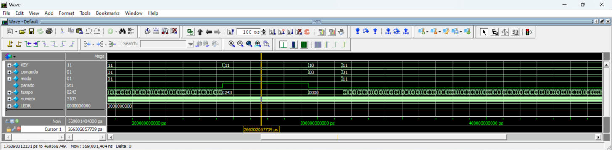<br><i>Figura 5 - Forma de onda do tb_reflexo: o tempo congela em 0243 quando o botão é apertado</i></p>

<p align="center">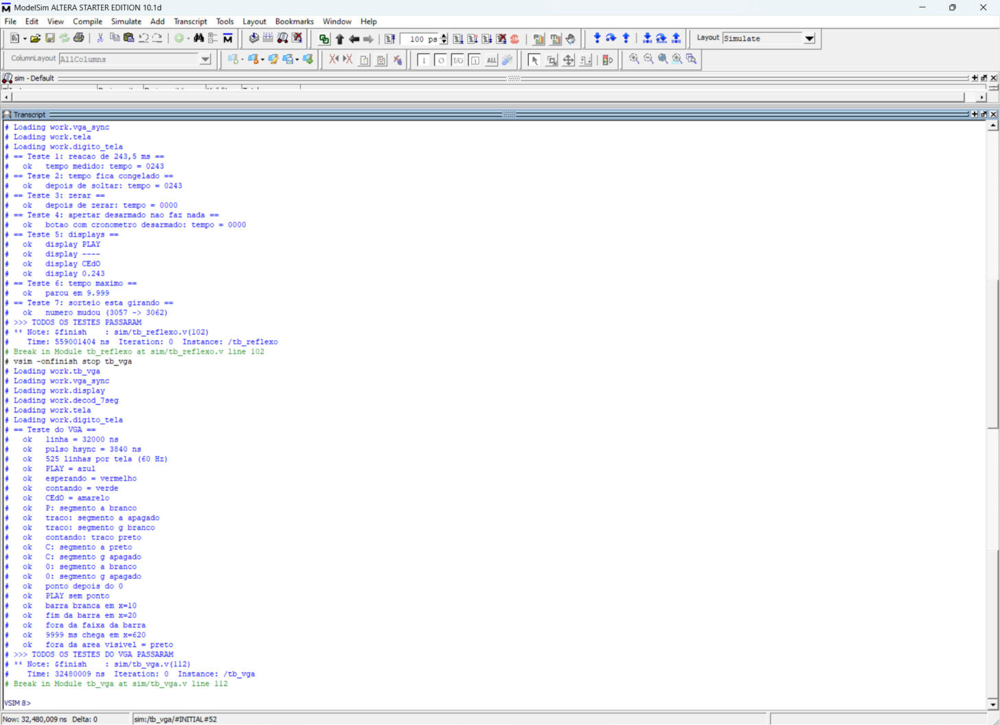<br><i>Figura 6 - Transcript do ModelSim com o resultado dos testes</i></p>

## 10. Compilação no Quartus

Resultado da compilação (Quartus Prime Lite 18.1, 10M50DAF484C7G):

| Item | Resultado |
|---|---|
| Erros | 0 |
| Elementos lógicos | 2.182 de 49.760 (4%) |
| Memória | 273.408 bits de 1.677.312 (16%), quase tudo é a RAM de 32 KB do Nios |
| Pinos | 75 de 360 |
| Timing | sobra 8,151 ns no clock de 50 MHz (pior caso) |
| Programa em C | 10 KB, sobram 20 KB pra pilha |

O timing passa com folga: o caminho mais lento leva uns 12 ns e o clock dá 20 ns por ciclo.

<p align="center">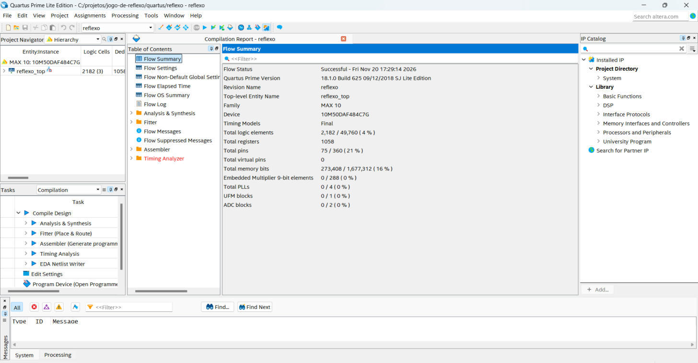<br><i>Figura 7 - Resumo da compilação no Quartus</i></p>

## 11. Testes na placa

Gravamos o projeto na DE10-Lite com o `JOGAR.bat` e testamos todas as regras do jogo. O VGA ainda não foi testado na placa porque não tínhamos um monitor com entrada VGA na hora do teste.

| Teste | Resultado |
|---|---|
| Início | display mostra `PLAY` |
| Começar a rodada (KEY0) | display mostra `----` e espera o tempo sorteado |
| Hora de apertar | os 10 LEDs acendem |
| Apertar o KEY0 | o tempo aparece no display (ex. 0.150) e no terminal |
| Novo recorde | os LEDs piscam 3 vezes e o terminal mostra NOVO RECORDE |
| Apertar antes dos LEDs | display mostra `CEdO` e a rodada não vale |
| Ninguém aperta | o tempo para em `9.999` e o terminal mostra Tempo esgotado |
| Várias rodadas | o ranking fica em ordem, do menor tempo pro maior |
| Apertar o KEY1 | recorde e ranking apagados, o terminal mostra "Recorde e ranking apagados!" |

O melhor tempo que conseguimos foi 0,150 s. A maioria das rodadas ficou entre 0,15 e 0,40 s.

<p align="center">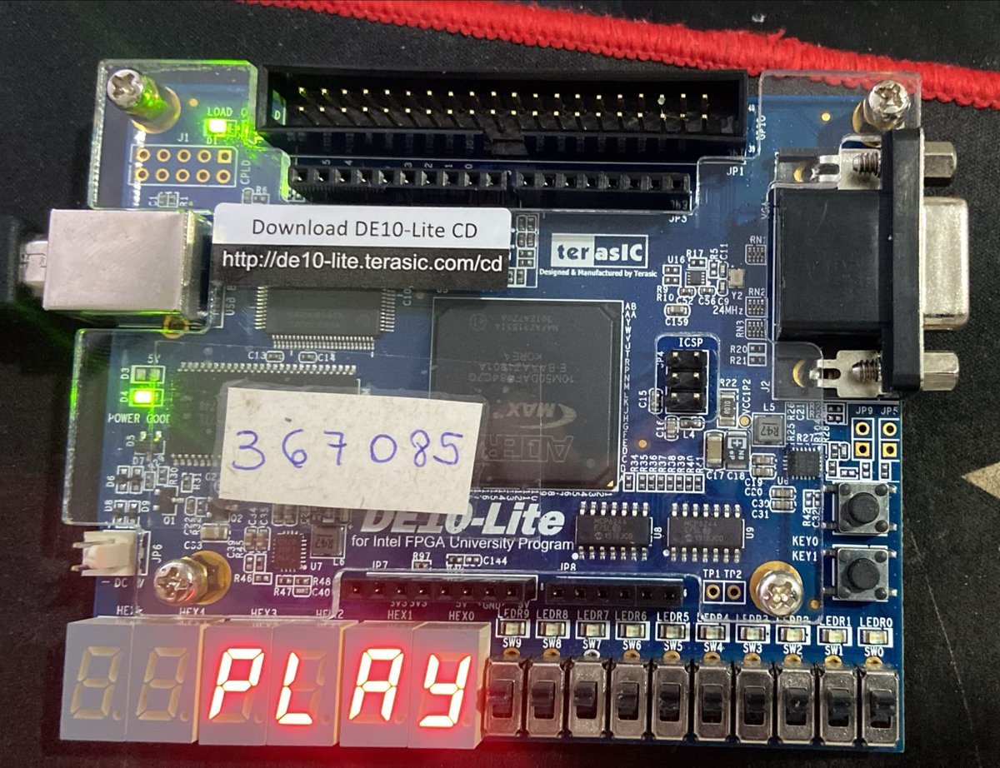<br><i>Figura 8 - Início da rodada, display mostrando PLAY</i></p>

<p align="center">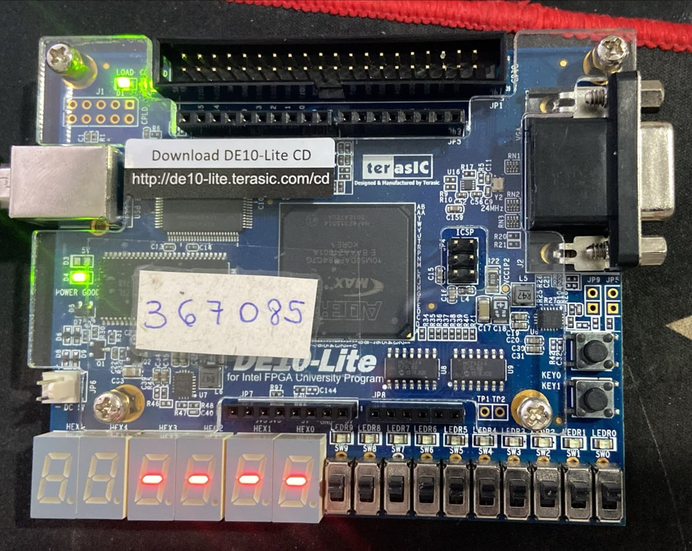<br><i>Figura 9 - Esperando os LEDs acenderem</i></p>

<p align="center">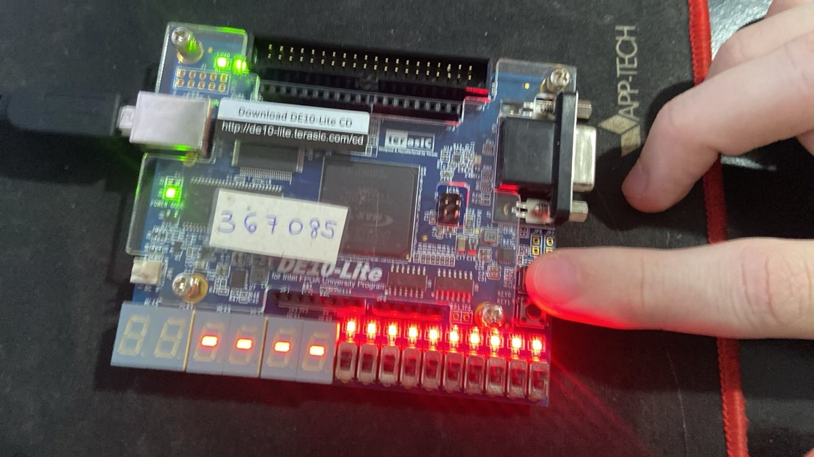<br><i>Figura 10 - LEDs acesos, hora de apertar o KEY0</i></p>

<p align="center">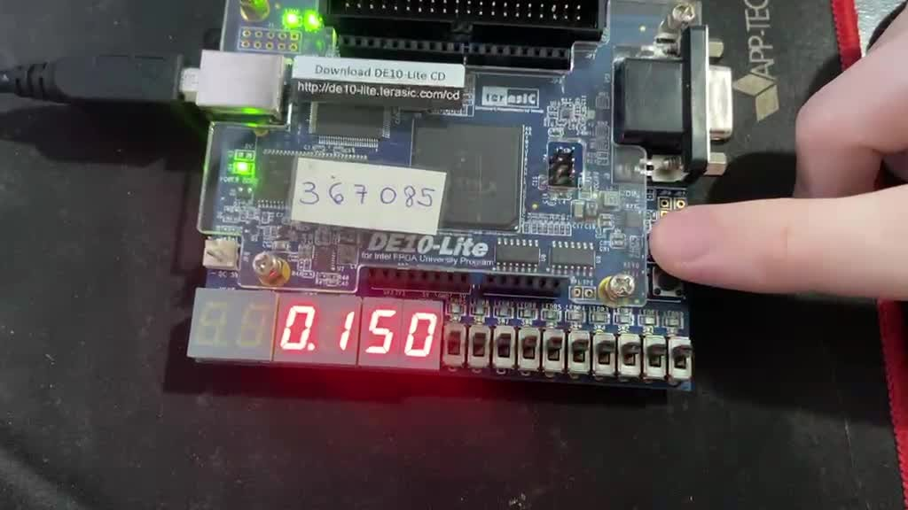<br><i>Figura 11 - Tempo de reação de 0,150 s no display</i></p>

<p align="center">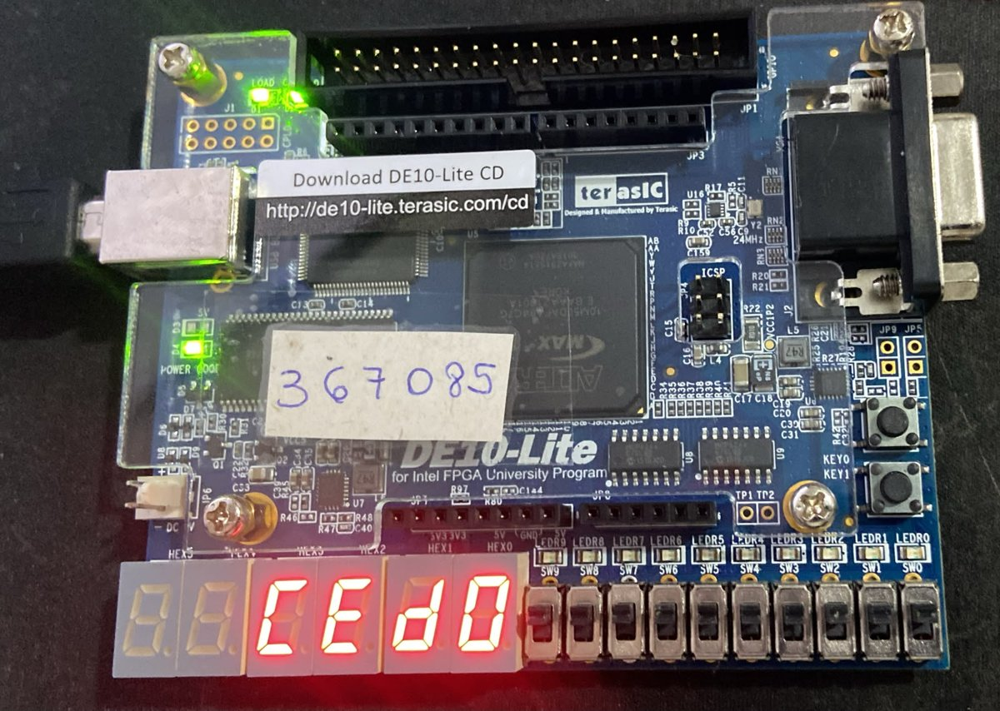<br><i>Figura 12 - Jogador apertou antes da hora (CEdO)</i></p>

<p align="center">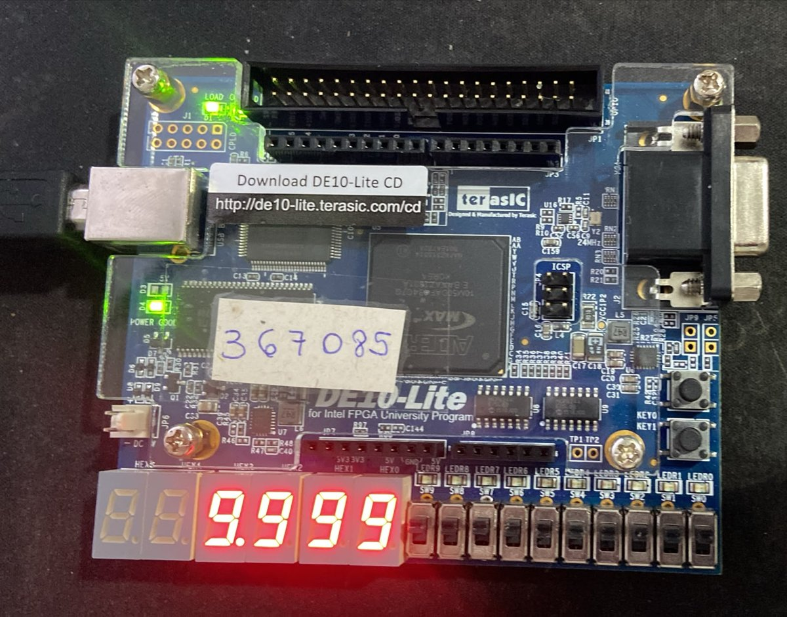<br><i>Figura 13 - Ninguém apertou e o tempo parou em 9.999</i></p>

## 12. Problemas que podem acontecer

- O Programmer não acha a placa ("Programming hardware cable not detected"): falta o driver do USB-Blaster. No Windows 11 aconteceu com a gente o erro de código 39 ao instalar o driver; resolvemos desligando a Integridade de memória (Segurança do Windows > Segurança do dispositivo > Isolamento de núcleo) e reiniciando o computador.
- O display mostra coisa estranha: algum pino errado, conferir com o manual da DE10-Lite.
- O Eclipse dá "System ID mismatch": gravar o `.sof` de novo e gerar o BSP de novo.
- O display fica parado em `PLAY`: o programa não está rodando no Nios.
- O jogo trava no meio: não pode fechar a janela do terminal do Nios, porque o `printf` fica esperando o computador ler. Se fechar, é só rodar o `JOGAR.bat` de novo.
- O monitor diz "sem sinal": conferir o cabo VGA e se a entrada do monitor está em VGA. Monitor só com HDMI precisa de um adaptador VGA para HDMI ativo (com USB).

## 13. Conclusão

O jogo funcionou na placa e atendeu ao que a gente queria: o tempo de reação é medido com precisão de 1 ms e a parada acontece no mesmo clock do aperto, porque quem mede é o hardware. O Nios II ficou só com as regras do jogo, que são bem mais simples de escrever em C, como o ranking e as mensagens no terminal.

A parte mais trabalhosa foi a ligação entre o Nios e o Verilog pelos PIOs, e acertar a versão do Quartus que suporta ao mesmo tempo a DE10-Lite e o Nios II no Windows. Separar o projeto em módulos pequenos ajudou bastante, porque deu pra testar cada parte no ModelSim antes de juntar tudo.

## 14. Referências

- JVKRAN. Response-Time-Game. GitHub. Disponível em: https://github.com/JVKran/Response-Time-Game. A ideia do jogo veio desse projeto, da lista indicada pelo professor. A gente refez pra DE10-Lite usando o Nios II.
- TERASIC. DE10-Lite User Manual. Pinos da placa.
- INTEL. Nios II Processor Reference Guide.
- INTEL. Embedded Peripherals IP User Guide (PIO e JTAG UART).
